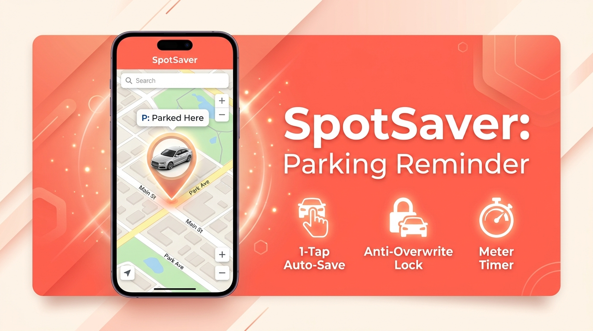
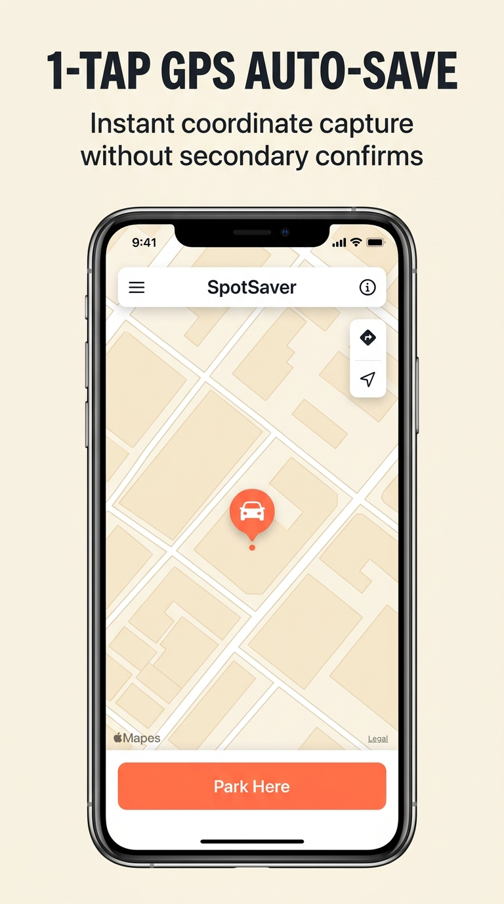
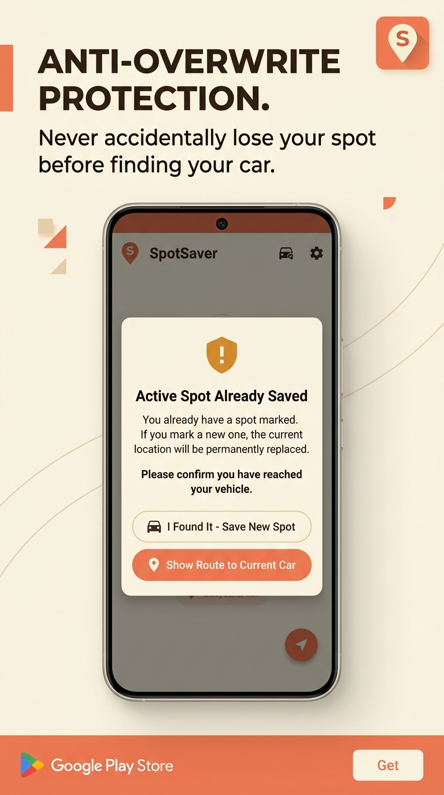
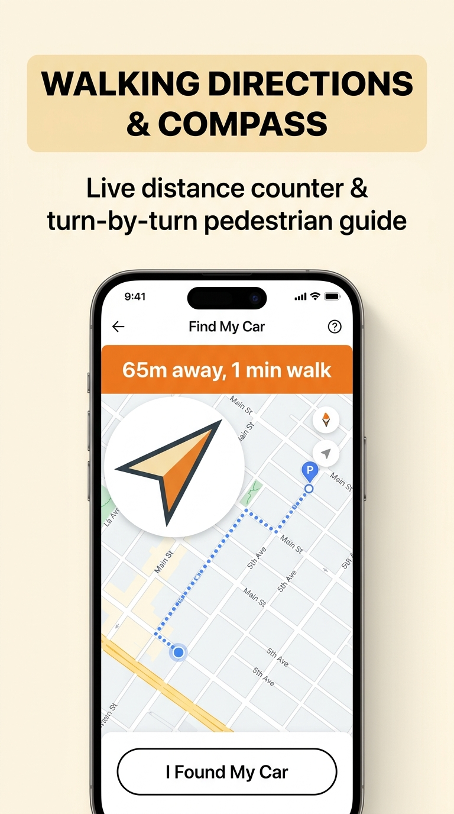
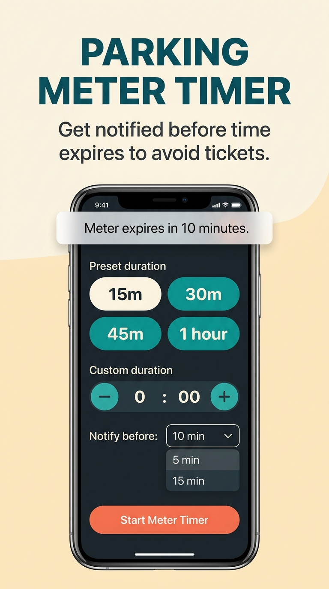
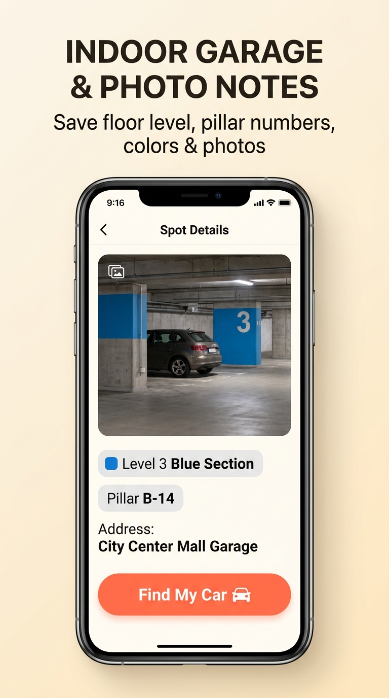

<p align="center">
  
</p>

<h1 align="center">SpotSaver: Smart GPS Parking Reminder</h1>

<p align="center">
  <strong>Never lose your parked car again. 1-tap GPS auto-save, anti-overwrite spot lock, walking compass directions, parking meter alarms, and multi-level garage notes.</strong>
</p>

<p align="center">
  <a href="https://play.google.com/store/apps/details?id=com.spotsaver.parkingreminder"></a>
  
  
  
  
  
  
</p>

<br />

<p align="center">
  
</p>

---

## 📖 Overview

**SpotSaver** is an ultra-fast, privacy-first Android parking utility engineered for drivers navigating busy city streets, crowded airport garages, and expansive shopping mall parking decks.

Unlike generic parking apps that easily overwrite your saved location with accidental taps, **SpotSaver** introduces an intelligent **Anti-Overwrite Protection System** that guards your saved coordinates until you explicitly confirm finding your vehicle.

---

## 📱 App Screenshots

<table align="center">
  <tr>
    <td align="center" width="20%">
      <br />
      <b>📍 1-Tap GPS Save</b><br />
      <sub>Instant coordinate lock with address geocoding</sub>
    </td>
    <td align="center" width="20%">
      <br />
      <b>🛡️ Overwrite Lock</b><br />
      <sub>Never lose your original spot accidentally</sub>
    </td>
    <td align="center" width="20%">
      <br />
      <b>🧭 Walking Compass</b><br />
      <sub>Turn-by-turn distance and real-time heading</sub>
    </td>
    <td align="center" width="20%">
      <br />
      <b>⏱️ Meter Timer</b><br />
      <sub>Countdown alarms before parking expires</sub>
    </td>
    <td align="center" width="20%">
      <br />
      <b>🏢 Garage Notes</b><br />
      <sub>Photos, levels, sections & pillar numbers</sub>
    </td>
  </tr>
</table>

---

## 🌟 Key Features

### 📍 1-Tap Instant GPS Auto-Save
- Captures high-accuracy GPS coordinates with a single tap.
- Automatically calculates satellite accuracy radius in meters/feet.
- Real-time reverse geocoding translates coordinates into human-readable street addresses.

### 🛡️ Smart Anti-Overwrite Protection
- Solves the #1 complaint in parking reminder apps: accidentally pressing "Save" while shopping and losing your car's true location.
- Prompts an intelligent warning dialog with options: *Keep Current Spot*, *Mark Found & Save New*, or *Navigate to Existing*.

### ⚡ Android Launcher Shortcuts
- Long-press the app icon directly from your Android Home Screen to trigger:
  - 🚗 **"Park Here"** — Saves parking instantly in under 1 second.
  - 🔍 **"Find My Car"** — Opens walking directions immediately.

### ⏱️ Parking Meter Countdown Alarms
- Avoid expensive parking tickets with quick 15, 30, 45, and 60-minute meter timers.
- Sound & vibration chimes notify you 5–10 minutes before your meter expires.

### 🏢 Multi-Level Garage & Pillar Notes
- Built for underground and multi-deck parking lots where satellite GPS is weak:
  - Snap high-resolution camera photos of pillar numbers and floor colors.
  - Store Section codes (e.g., *Level B2, Zone Green, Pillar #42*).
  - Color-tag spots for visual recall.

### 🧭 Real-Time Walking Compass & Navigation
- Live distance meter (meters/feet) that updates dynamically as you walk.
- Heading compass arrow with dynamic device rotation.
- Direct 1-tap handoff to Google Maps walking navigation.

### 🚗 Bluetooth Handsfree Disconnect Auto-Detection
- Pairs with your car's Bluetooth audio system.
- Automatically triggers a parking prompt the moment your vehicle engine turns off and Bluetooth disconnects.

### 🔒 100% Privacy & On-Device Storage
- Zero external tracking, zero analytics profiling, zero required user logins.
- All locations, notes, and photos remain strictly on your device.
- Includes a 1-tap **"Erase All App Data"** button in Settings for complete compliance with Google Play data safety policies.

---

## 🛠️ Architecture & Tech Stack

| Layer | Technology | Description |
| :--- | :--- | :--- |
| **Framework** | [React 18](https://react.dev/) + [TypeScript](https://www.typescriptlang.org/) | Type-safe, modular UI components |
| **Mobile Runtime** | [Capacitor 8](https://capacitorjs.com/) | Native Android bridge with native webview |
| **Bundler** | [Vite 6](https://vitejs.dev/) | Lightning-fast HMR and optimized production bundling |
| **Styling** | [Tailwind CSS 3.4](https://tailwindcss.com/) | Modern responsive design with custom luxury color palette |
| **Icons** | [Lucide React](https://lucide.dev/) | Clean, consistent vector iconography |
| **Monetization** | [@capacitor-community/admob](https://github.com/capacitor-community/admob) | Native Google AdMob banner & consent management |
| **Platform Target** | Android 15 (Target SDK 36, Min SDK 24) | Compatible with 99%+ of Android devices globally |

---

## 📂 Project Directory Structure

```text
spotsaver/
├── android/                             # Native Android Studio Project
│   ├── app/
│   │   ├── src/main/
│   │   │   ├── AndroidManifest.xml      # App permissions, AdMob metadata, shortcuts
│   │   │   ├── java/                    # Native Android MainActivity
│   │   │   └── res/                     # Splash screens, app icons & XML config
│   │   └── build.gradle                 # Target SDK 36, signing configuration
│   └── build.gradle
├── docs/                                # Documentation & screenshots showcase
│   └── screenshots/
│       ├── banner.png
│       ├── icon.png
│       └── screenshot_*.png
├── public/                              # PWA assets & store graphics
│   ├── app-ads.txt                      # AdMob authorized inventory specification
│   ├── manifest.json                    # Web application manifest
│   └── robots.txt
├── src/
│   ├── components/                      # UI Screens & Modals
│   │   ├── HomeScreen.tsx               # Main map, 1-tap save & active spot HUD
│   │   ├── FindMyCarScreen.tsx          # Real-time compass & walking directions
│   │   ├── HistoryScreen.tsx            # Saved spots log with AdMob banner dock
│   │   ├── SettingsScreen.tsx           # Preferences, vehicle profile & data erase
│   │   ├── OnboardingScreen.tsx         # Modern first-run walkthrough
│   │   ├── TimerModal.tsx               # Parking meter countdown alarm picker
│   │   └── SpotDetailsModal.tsx         # Garage photo viewer & pillar notes
│   ├── services/                        # Native plugin bridges & GPS utilities
│   │   ├── admobService.ts              # Native AdMob banner lifecycle manager
│   │   └── audioService.ts              # Haptic feedback & audio chimes
│   ├── types.ts                         # TypeScript data schemas
│   ├── App.tsx                          # Root state & navigation orchestration
│   └── main.tsx                         # Entry point
├── capacitor.config.ts                  # Capacitor mobile bridge configuration
├── tailwind.config.js                   # Custom theme & typography styling
├── vite.config.ts                       # Vite build configuration
└── package.json
```

---

## 🚀 Getting Started

### Prerequisites

Ensure you have the following installed on your development machine:
- [Node.js](https://nodejs.org/) (v18.x or later)
- [npm](https://www.npmjs.com/) (v9.x or later)
- [Android Studio](https://developer.android.com/studio) (Ladybug / Koala or later)
- Java Development Kit (JDK 17 or JDK 21)
- Android SDK Platform 36 (Android 15)

---

### Installation & Local Web Development

1. **Clone the repository:**
   ```bash
   git clone https://github.com/ahmedmostafa002/Parking-Reminder-App.git
   cd Parking-Reminder-App
   ```

2. **Install project dependencies:**
   ```bash
   npm install
   ```

3. **Start the local Vite development server:**
   ```bash
   npm run dev
   ```
   Open your browser at `http://localhost:5173` to test the responsive web UI.

---

### Running on Android Device / Emulator

1. **Build the production web assets:**
   ```bash
   npm run build
   ```

2. **Sync web code to native Android:**
   ```bash
   npx cap sync android
   ```

3. **Open in Android Studio:**
   ```bash
   npx cap open android
   ```
   *Connect your phone via USB or Wireless ADB, then press **Run ▶** in Android Studio.*

---

## 📦 Building Production Release (.aab)

To generate a signed **Android App Bundle (.aab)** ready for Google Play Console:

1. Build web assets and sync:
   ```bash
   npm run build
   npx cap sync android
   ```

2. Compile the release bundle using Gradle:
   ```bash
   cd android
   ./gradlew bundleRelease
   ```

The compiled bundle will be generated at:
```text
android/app/build/outputs/bundle/release/app-release.aab
```

---

## 🔒 Security & Keystore Policy

For security reasons, production upload keystores (`*.keystore`, `*.jks`) and local properties files are strictly excluded via [`.gitignore`](.gitignore). 

To sign release builds locally:
1. Place your private keystore file in `android/app/spotsaver-upload-key.keystore`.
2. Configure credentials in `android/app/build.gradle` or via environment variables.

---

## 📄 License & Attribution

Distributed under the **MIT License**. See `LICENSE` for more information.

- **Developer:** Unity Electronic
- **Official Portal:** [https://techask2021.github.io](https://techask2021.github.io)
- **Privacy Policy:** [Privacy Policy](https://sites.google.com/view/spotsaver-privacy/home)

<p align="center">
  <sub>Built with ❤️ for drivers worldwide.</sub>
</p>
